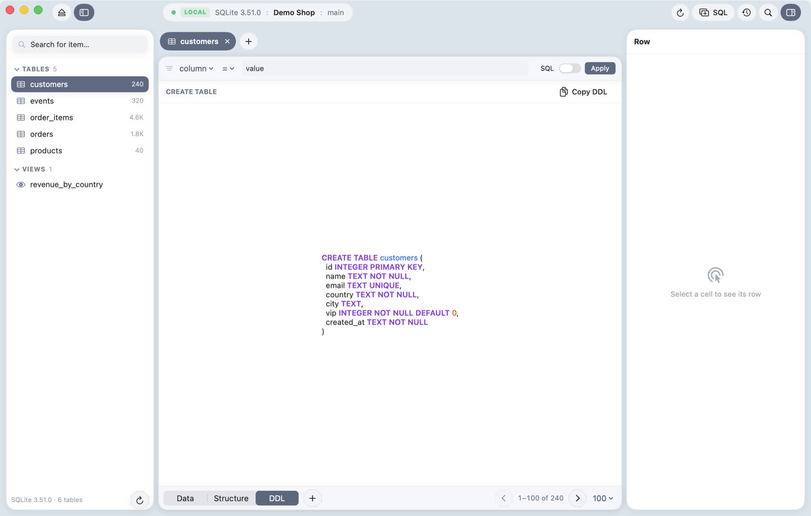
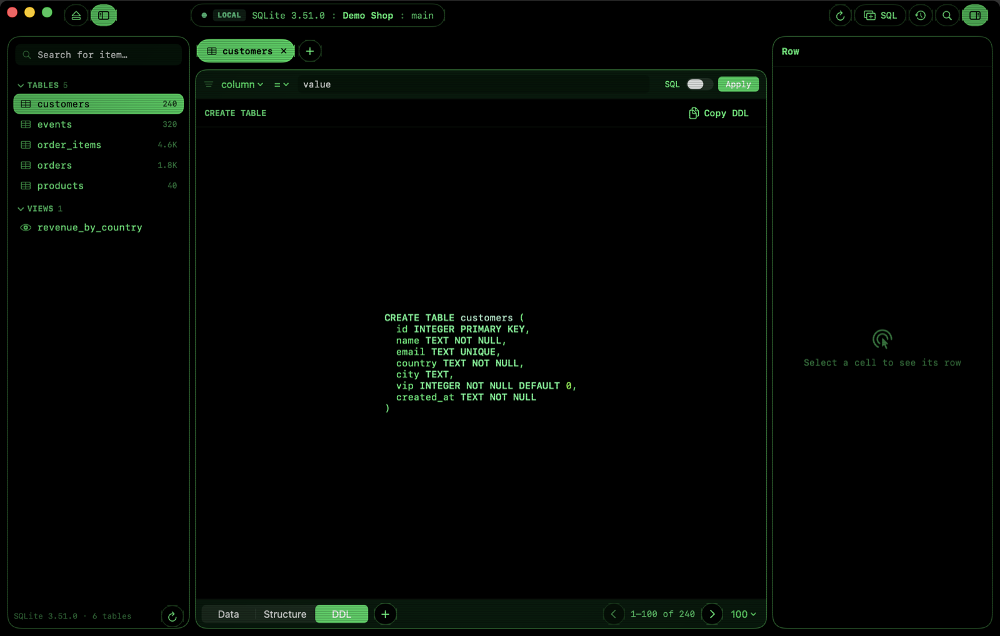
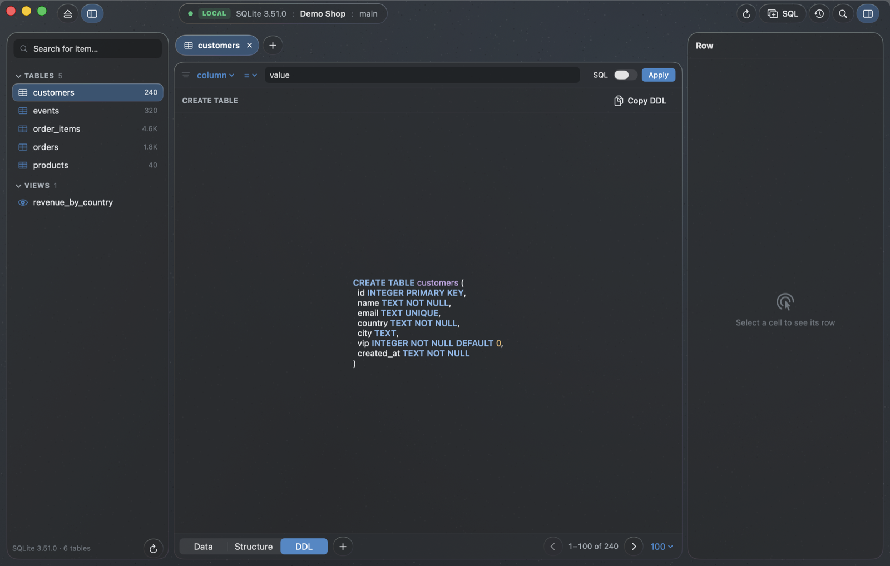
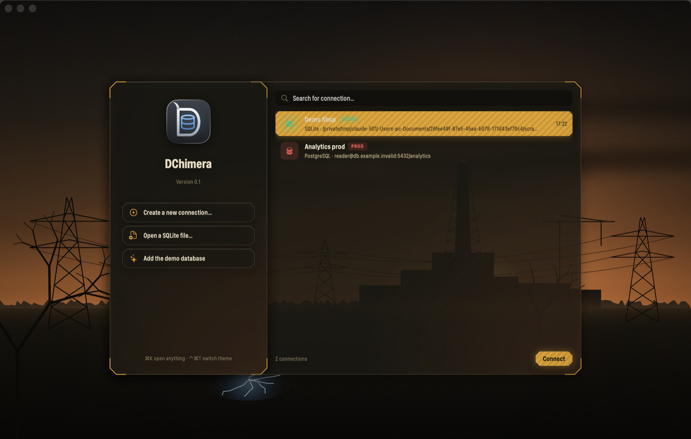
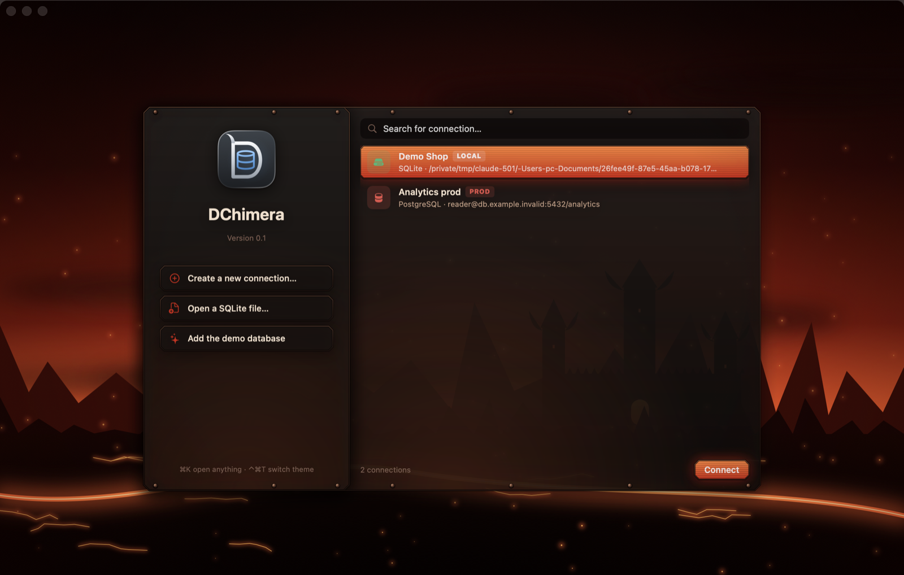
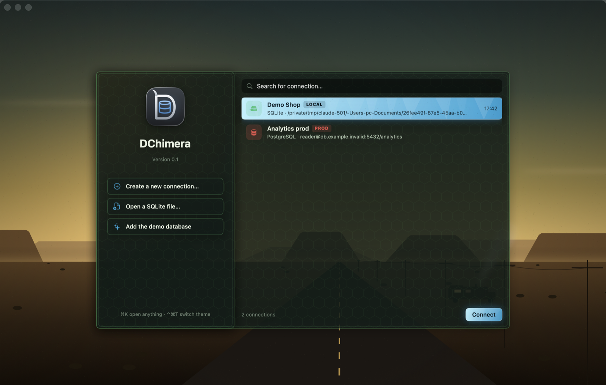

# DChimera

**Data Chimera.** A chimera is a lion, a goat and a serpent in one body. DChimera is one database client wearing many skins. The icon is a contour monogram: a silver D with a chimera's horn and a database cylinder inside.

DChimera is a native database client for macOS (SwiftUI + AppKit, macOS 14+). It supports PostgreSQL, SQLite and MySQL (beta) and comes with six themes. The app measures where the window's close / minimize / zoom buttons are, so they never overlap the interface. The Windows and Linux version lives in [dchimera-desktop](https://github.com/HardCodWorker/dchimera-desktop).

Every theme uses the same table-first workspace:
- a start screen with connections and LOCAL / DEV / PROD tags;
- a toolbar, a table list, and tabs for tables and SQL queries;
- a column / operator / value filter;
- **Data / Structure / DDL** modes and a panel with the fields of the selected row.

Themes only change the look:

| Theme | Look |
| --- | --- |
| **Chat** | Light (or dark) messenger palette, flat cards with soft shadows. |
| **Matrix** | Black background, green monospaced text, green frames, scanlines. |
| **Wet Asphalt** | Wet-asphalt graphite on Liquid Glass (macOS 26): translucent panels, with tabs and buttons as glass droplets. Minimal, no animation. |
| **Stalker** | The Zone at dusk: a rusty sky, a power plant with a vent stack, an unfinished cooling tower, power lines, dead trees and an electrical anomaly. Panels have cut corners and yellow brackets. Selections are radiation yellow with hazard stripes, the type is condensed, and film grain covers the window. A toolbar dosimeter stays calm when idle and spikes red while a query runs. Turning the theme on plays an "Emission". |
| **Doom** | Hell at dusk: a burning sky, jagged mountains, a fortress with horned towers and a fiery gate, a lava river with cracks and floating embers. Panels are dark riveted metal plates with bevelled corners, and selections are hellfire red with a grate. A toolbar RAGE meter smolders when idle and flares during queries. Turning the theme on melts the screen away in columns. |
| **Breaking Bad** | A desert at golden hour: mesas, a straight road with telephone poles, an old RV with a thin plume of smoke. Panels are dark lab green with a hexagon lattice, selections are faceted blue crystal, and SQL keywords are element green. The toolbar shows purity at 99.x%, and "cooking…" while a query runs. Turning the theme on releases a haze and scatters crystals. |








**Table DDL:** open a table and pick **DDL** in the switcher at the bottom. It shows the highlighted CREATE statement and a Copy DDL button. You can also right-click a table in the list and choose **Show DDL** or **Copy DDL**.

**Switching themes:** Settings (⌘,) → Theme, ⌘K → "Theme: …", or ⌃⌘T to cycle through them.

## Features

- **Connections:** PostgreSQL, SQLite and MySQL (beta). Passwords are stored only in the macOS Keychain.
- **SQL editor:**
  - highlighting;
  - completion of tables and columns, aware of aliases;
  - `.sql` files and history;
  - ⌘↩ / ⇧⌘↩ to run.
- **Tables:**
  - a native AppKit grid that scrolls smoothly through thousands of rows;
  - paging, sorting and a `WHERE` filter;
  - cell editing on double click, deleting and adding rows.
  
  Changes are saved in one transaction, and you can review the SQL first.
- **⌘K:** jump to a connection, a table, a query from history, or a theme.
- **Export:** CSV, JSON, Markdown.
- **Updates:** DChimera checks GitHub Releases and updates itself (see below).
- **Claude (MCP):** Claude Code, Claude Desktop or Cursor can read your databases through DChimera, and change them if you allow it (see below).

## Safety for production databases

- **Read-only connections:** the server itself rejects writes.
  - PostgreSQL gets `default_transaction_read_only=on`.
  - MySQL gets `SET SESSION TRANSACTION READ ONLY`.
  - SQLite is opened read-only.
- DChimera asks for confirmation before `DROP`, `TRUNCATE`, `ALTER`, and `DELETE` / `UPDATE` without `WHERE`.
- A `SELECT` in a query tab is wrapped as `SELECT * FROM (…) AS dchimera_rows LIMIT n+1`. n is the row limit from Settings, 1000 by default.
- For PostgreSQL and MySQL, `count(*)` never runs on its own: row counts come from statistics. For an exact number, press **Count**.

## Claude and other AI assistants (MCP)

DChimera is also an [MCP](https://modelcontextprotocol.io) server. Claude starts DChimera in the background (no window opens) and works with the connections you saved in DChimera. Passwords stay in the Keychain: Claude only sees connection names.

You choose the access when you connect Claude. Register two servers and turn on the one you need:

| Server | Command | Tools |
| --- | --- | --- |
| `dchimera-read` | `DChimera --mcp` | `list_connections`, `list_tables`, `describe_table`, `query` |
| `dchimera-write` | `DChimera --mcp --write` | the same plus `execute` and `add_connection` |

**Claude Code:** Settings → Claude (MCP) → **Copy command** for each mode, then run it in Terminal:

```bash
claude mcp add --scope user dchimera-read -- /Applications/DChimera.app/Contents/MacOS/DChimera --mcp
```

```bash
claude mcp add --scope user dchimera-write -- /Applications/DChimera.app/Contents/MacOS/DChimera --mcp --write
```

Turn either one on or off in a session with `/mcp`.

**Claude Desktop, Cursor:** **Copy config** gives both entries for `mcpServers` in the client's config file (for Claude Desktop, `~/Library/Application Support/Claude/claude_desktop_config.json`). Restart the client, then turn on the one you need in its tools menu.

What each tool does:
- `query` takes one SELECT / WITH / VALUES / TABLE / SHOW / EXPLAIN statement, opens the connection read-only and runs the statement in a read-only transaction. It returns up to 200 rows by default (`max_rows`, capped by the row limit in Settings).
- `execute` runs any SQL, several statements in a row on one connection, so `BEGIN` … `COMMIT` works. DROP, TRUNCATE, ALTER and DELETE / UPDATE without WHERE open a DChimera confirmation window first (the same "Ask before…" setting as in the app). Only a mouse click on **Run anyway** runs it: the keyboard can only cancel.
- `add_connection` saves a new PostgreSQL, MySQL or SQLite connection after checking that it connects. Claude never gets the password: DChimera opens a window where you type it, and keeps it in the Keychain. A running DChimera shows the new connection at once.

In Settings → Claude (MCP):
- **Let Claude use DChimera** turns every server off at once, even while Claude is connected.
- Each connection has a switch. Read-only (prod) connections start hidden, because whatever Claude reads is sent to the model. A read-only connection stays read-only for `dchimera-write` too.
- Claude Code also asks you before each tool call unless you allow it. A good setup is to always allow `query` and confirm `execute` each time.

## Install

Download `DChimera-X.Y.Z.dmg` from [Releases](https://github.com/HardCodWorker/dchimera/releases) and drag DChimera to Applications. The app is not signed with an Apple certificate, so macOS blocks the first launch:

- **macOS 15 and later:** open DChimera and click "Done". Then go to System Settings → Privacy & Security and click "Open Anyway" at the bottom.
- **macOS 14:** right-click DChimera in Applications → Open → Open.
- **Or in Terminal:**

```bash
xattr -dr com.apple.quarantine /Applications/DChimera.app
```

## Build from source

You need Xcode 16 or later (tested with Xcode 26.6) and [XcodeGen](https://github.com/yonaskolb/XcodeGen).

```bash
xcodegen generate && open DChimera.xcodeproj
```

Or build a Release from the terminal:

```bash
xcodebuild -project DChimera.xcodeproj -scheme DChimera -configuration Release -derivedDataPath build build
```

```bash
open build/Build/Products/Release/DChimera.app
```

Run `xcodegen generate` again after adding a new `.swift` file.

## Updates

DChimera checks [GitHub Releases](https://github.com/HardCodWorker/dchimera/releases) 4 seconds after launch. You can turn this off in Settings → Updates.

To check by hand, use any of these:
- **Check for updates…** on the start screen;
- the menu **DChimera → Check for Updates…**;
- Settings → **Check Now**.

When a newer version exists, the start screen shows **Update to X.Y.Z…** and the toolbar gets an **Update** button. **Install & Relaunch** does the rest:
1. It downloads the release's `.dmg`.
2. It checks that the app inside is DChimera of that version with an intact signature.
3. It puts the new app in place of the old one and relaunches.

If anything is wrong, the old version stays. The app must sit in a folder you can write to, usually `/Applications`.

One release `vX.Y.Z` carries the files for every platform:

| Platform | Files |
| --- | --- |
| macOS | `DChimera-X.Y.Z.dmg` |
| Windows | `DChimera-Setup-X.Y.Z-x64.exe` and `latest.yml` |
| Linux | `DChimera-X.Y.Z-x86_64.AppImage`, `dchimera_X.Y.Z_amd64.deb` and `latest-linux.yml` |

The Windows/Linux app reads the same release.

## Releasing a new version

1. Set the version. Use the same number in `dchimera-desktop/package.json`.

```bash
scripts/set-version.sh 0.1.1
```

2. Build the universal `.dmg` (Apple silicon + Intel):

```bash
scripts/release-macos.sh
```

3. Create the GitHub release with the `.dmg`:

```bash
gh release create v0.1.1 dist/DChimera-0.1.1.dmg --repo HardCodWorker/dchimera --title "DChimera 0.1.1" --notes "What's new"
```

4. Upload the Windows/Linux files from `dchimera-desktop/dist` to the same release with `gh release upload v0.1.1 … --repo HardCodWorker/dchimera`.

**Testing updates without GitHub (Debug builds):**
- `DCHIMERA_UPDATE_URL=file:///path/latest.json` points the app at a JSON file in the format of GitHub's `releases/latest` response.
- `DCHIMERA_UPDATE_SELFTEST=/path/log.txt` makes the app check and install by itself.

## Connect your PostgreSQL

1. Press ⌘N.
2. Choose PostgreSQL and fill in Host, Port, Database, User and Password.
3. Pick an SSL mode:
   - `Prefer` uses TLS when the server supports it;
   - `Require` is for RDS and other clouds;
   - `Verify` also checks the certificate.
4. Turn on **Read-only** for production databases.
5. Click **Test connection**, then **Save & open**.

## Keyboard shortcuts

| Keys | Action |
| --- | --- |
| ⌘↩ | run the selection or the statement under the cursor |
| ⇧⌘↩ | run everything in the editor |
| ⌘K | quick switcher |
| ⌘T | new SQL tab |
| ⌃⌘T | next theme |
| ⌘N | new connection |
| ⌘R | refresh the table or the schema |
| ⌘S | save table edits |
| ⌘[ | back to the connection list |
| ⌘1…9 | open connection 1–9 |

## Where data lives

- **Connections:** `~/Library/Application Support/DChimera/connections.json` (without passwords).
- **History:** `~/Library/Application Support/DChimera/history/<id>.json`.
- **Claude (MCP) switch:** `~/Library/Application Support/DChimera/mcp.json`. Per-connection access is stored in `connections.json`.
- **Passwords:** the Keychain, service `dev.baza.app.connection`. The name is left over from the app's first name, so saved passwords keep working.
- **Bundle id:** `dev.dchimera.app`.

## Known limitations

- MySQL has not been tested against a live server (beta).
- Rare PostgreSQL types are shown as hex. Cast them with `::text`.
- A running query cannot be cancelled.
- The app is signed ad hoc, so after a rebuild the Keychain may ask for access once.

## Project layout

```
DChimera/
  App/          AppModel, DBSession (query tabs, schema, history), TableDataModel, DemoDatabase, Updater (GitHub Releases)
  Drivers/      SQLite (libsqlite3), PostgreSQL (PostgresNIO), MySQL (MySQLNIO), SQLDialect
  Storage/      JSON files, Keychain, migration from the old app name
  Theme/        Skin (colors, fonts, shapes), SkinViews (Liquid Glass, digital rain, asphalt texture),
                ZoneViews (Stalker), DoomViews (Doom), LabViews (Breaking Bad), Components
  Views/        Workspace (start screen, toolbar, list, tabs, filter, Data/Structure/DDL, row panel),
                Grid (NativeGrid on NSTableView), Editor (SQL editor), QuickSwitcher, ConnectionEditor, Settings, UpdateDialog
  MCP/          MCP server for Claude (`DChimera --mcp [--write]`): JSON-RPC over stdio, tools, settings
  Debug/        self-test and benchmarks (Debug builds only)
project.yml     XcodeGen project description
scripts/        release-macos.sh (builds the .dmg), set-version.sh, make-icon.swift
```

## Self-test (Debug)

Debug builds read these environment variables:

| Variable | What it does |
| --- | --- |
| `DCHIMERA_DATA_DIR` | a temporary folder instead of your real data |
| `DCHIMERA_DEMO_OUT` | runs a tour of every theme and saves snapshots and `tour.txt` there |
| `DCHIMERA_DEMO_ONLY` | limits the tour to some themes, for example `doom,breakingbad` |
| `DCHIMERA_BENCH_OUT` | grid benchmark |
| `DCHIMERA_GLASS_FALLBACK=1` | frosted material instead of system glass (snapshots cannot draw Liquid Glass) |
| `DCHIMERA_MCP_CONFIRM=yes` / `no` | answers the MCP confirmation window without showing it |
| `DCHIMERA_MCP_PASSWORD=…` | answers the add_connection password window without showing it (`<cancel>` cancels) |
| `DCHIMERA_MCP_WINDOW_TEST=1` / `keys` | shows the real MCP windows, logs whether they are on screen and closes them; `keys` also presses Tab, Space and Return in them |
| `DCHIMERA_SETTINGS_SHOT=/path.png` | renders Settings → Claude (MCP) into a PNG and quits |

```bash
DCHIMERA_DATA_DIR=/tmp/dchimera-test DCHIMERA_DEMO_OUT=/tmp/dchimera-shots build/Build/Products/Debug/DChimera.app/Contents/MacOS/DChimera
```
